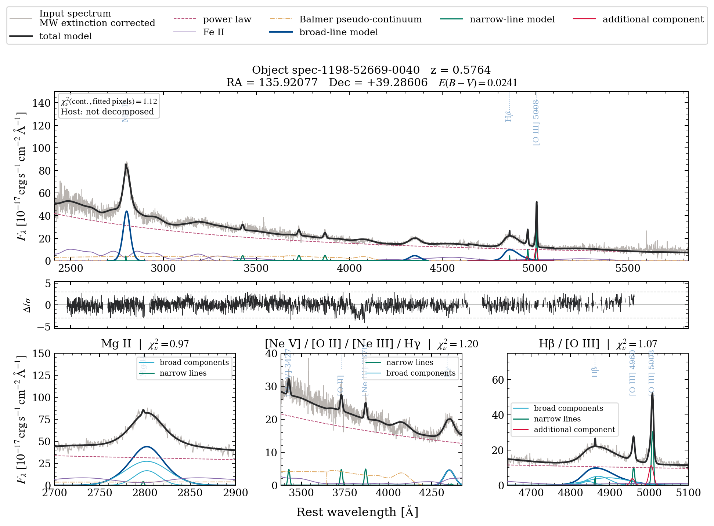

Fit your first quasar spectrum
==============================

Fit a real SDSS DR17 quasar, inspect the continuum and emission lines, and
read its broad-Hβ width. The source is ``spec-1198-52669-0040.fits`` at
:math:`z=0.5764288`; SDSS classifies it as a quasar with ``ZWARNING=0``.

Before you begin
----------------

Follow :doc:`installation` and the one-time :doc:`Planck GNILC setup
<dustmaps>`. This tutorial uses the default ``global_v2`` continuum and
automatic line selection, with Galactic correction and no host subtraction.
You do not need pPXF or stellar templates.

1. Download and inspect the spectrum
------------------------------------

Astropy caches the public FITS file, so subsequent calls reuse it:

.. code-block:: python

   from astropy.utils.data import download_file
   import qsospec

   url = (
       "https://sas.sdss.org/sas/dr17/sdss/spectro/redux/26/"
       "spectra/lite/1198/spec-1198-52669-0040.fits"
   )
   path = download_file(url, cache=True)
   data = qsospec.read_spectrum(path, reader="sdss")
   print(data.redshift)        # 0.5764288306236267
   print(data.ra, data.dec)    # 135.92077, 39.286062 (degrees)
   print(data.metadata["flux_unit"], data.metadata["flux_scale"])
   # cgs 1e-17

For a local copy, assign its filename to ``path`` instead of downloading.
The file is read without modification.

The SDSS reader converts ``loglam`` to vacuum observed wavelength in Angstrom
and uses the catalog redshift and target coordinates. Flux and errors retain
the numerical SDSS scale of :math:`10^{-17}` times physical cgs flux density.
Nonpositive/nonfinite inverse variance and nonzero ``and_mask``/``or_mask``
flags are excluded. The returned boolean mask uses ``True`` for valid pixels.
See :doc:`spectral_basics` for units, frames and masks.

The rest range is approximately 2413–5825 Å. It includes Mg II, Hγ, Hβ and
[O III], while Hα and C IV fall outside the range. Predicting coverage before
fitting makes the resulting statuses easier to interpret.

2. Fit the continuum and covered lines
--------------------------------------

For an in-memory fit:

.. code-block:: python

   result = qsospec.fit_global_lines_workflow(
       path,
       object_id="spec-1198-52669-0040",
       run_host_decomp=False,
   )
   print("Continuum converged:", result.continuum_success)
   for recipe_id, status in result.complex_statuses.items():
       print(recipe_id, status)

If you want a saved analysis, use the :ref:`persistence call
<save-and-reload-this-analysis>` **instead of** this call. It returns the same
kind of result and also writes a run bundle.

Preparation applies Planck/F99 Galactic correction at observed wavelengths,
then converts wavelength, flux density and errors to the rest-frame
convention. The workflow fits a power law, enabled Fe II and Balmer components,
then the covered line complexes. It retains the supplied redshift.

For this source the continuum converges, and ``mgii``,
``oii_nev_neiii_hgamma`` and ``hbeta_oiii`` have status ``fit``. Hα, the UV
complexes and the Paschen complex are ``not_covered``. Recipe-specific valid
coverage, rather than wavelength endpoints alone, governs selection.

3. Inspect the fit
------------------

.. code-block:: python

   dust = result.metadata["galactic_extinction"]
   print(dust["status"], dust["source"], dust["applied_ebv"])
   # applied planck 0.024079106748104095
   print(result.warning_codes())

   figure = result.plot_qa()
   figure.savefig("sdss_quasar_qa.png", dpi=180, bbox_inches="tight")
   # In a notebook, result.show_qa() displays the figure directly.

   The example after Planck/F99 correction with :math:`E(B-V)=0.0241`,
   no host subtraction and the input redshift. Axes use rest wavelength
   and rest-frame flux density.

Inspect the component sum and unsmoothed residuals in the line zoom you need.
The total model includes each line complex only within its fitting windows;
between them it contains the global continuum and any applicable host.
Excluded finite pixels remain visible, but do not enter residual statistics.
``result.plot_qa(mark_excluded_pixels=True)`` highlights them with red crosses.

A converged continuum does not establish the reliability of every line.
The :doc:`QA guide <../user_guide/qa_plots>` explains bounds, coverage,
resolution warnings and model sensitivity.

4. Read a line measurement
--------------------------

.. code-block:: python

   hbeta = result.line_complexes.get("hbeta_oiii")
   if hbeta is not None and hbeta.success:
       width = hbeta.metrics["Hb_broad_fwhm_kms"]
       width_error = hbeta.metric_errors.get("Hb_broad_fwhm_kms", float("nan"))
       print(width, width_error)
       # Approximately 5841, 242 (km/s).

This width uses the summed broad-Hβ profile, excluding narrow Hβ, [O III]
and continuum. It includes instrumental broadening: the SDSS reader does not
construct an LSF from ``wdisp``. The error is a covariance estimate conditional
on the fitted continuum, adopted redshift and line model.

Continue to :ref:`read-first-measurement` for the component definition,
flux, rest EW, warnings and a save/reload walkthrough. The
:doc:`measurement dictionary <../reference/measurement_dictionary>` gives
exact field definitions and archive selectors.

Run the complete example as a script
------------------------------------

Download :download:`fit_sdss_quasar.py <../../examples/fit_sdss_quasar.py>`
and run it after configuring the dust map:

.. code-block:: bash

   python fit_sdss_quasar.py --output-dir validation/sdss_quickstart --write-run

From a checkout, use ``python examples/fit_sdss_quasar.py`` with the same
arguments. Add ``--input /path/to/spec-1198-52669-0040.fits`` for a local file
or ``--no-qa`` to skip plotting. The script fits once into ``output-dir/run``,
verifies broad-Hβ measurement recovery, and writes a QA PNG and
``provenance.json``. Downloads are cached under the output directory.

The :download:`recorded figure provenance
<../_static/sdss_quasar_provenance.json>` includes the source URL, input
SHA-256, preprocessing, statuses, warnings and measurement verification.
The numerical results above have been checked against the current source.
For your next target, follow :doc:`../how_to/fit_arrays` or
:doc:`../how_to/fit_file`.
