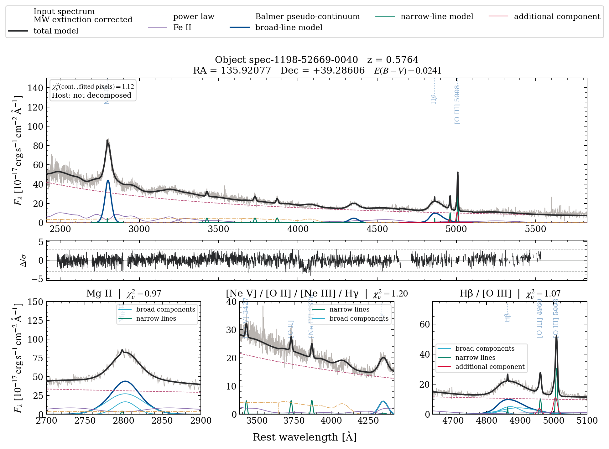

qsospec: quasar spectral fitting
================================

Measure quasar emission lines from UV, optical and near-infrared spectra.
Fit the continuum, separate blended line profiles, inspect residuals, and
keep the models and measurements together for your next analysis.

.. grid:: 1 1 2 2
   :gutter: 3

   .. grid-item-card:: Fit your first spectrum
      :link: getting_started/quickstart
      :link-type: doc

      Follow a real SDSS quasar from download to continuum and line fits.

   .. grid-item-card:: Use your own data
      :link: getting_started/choose_workflow
      :link-type: doc

      Choose a workflow for arrays, a file, local windows or a sample.

   .. grid-item-card:: Read a measurement
      :link: user_guide/results
      :link-type: doc

      Extract broad-Hβ width, flux and EW, with their uncertainties.

   .. grid-item-card:: Process a sample
      :link: user_guide/batch_fitting
      :link-type: doc

      Fit in parallel, resume work and build a catalog from saved results.

Start an analysis
-----------------

1. :doc:`Install qsospec <getting_started/installation>` and configure the
   :doc:`Galactic dust map <getting_started/dustmaps>`.
2. Run the :doc:`SDSS quickstart <getting_started/quickstart>` or
   :doc:`prepare your own arrays <how_to/fit_arrays>`.
3. :doc:`Check the QA figure <user_guide/qa_plots>` and the status of the
   line you need, then :doc:`read and save measurements <user_guide/results>`.

The :doc:`spectral conventions <getting_started/spectral_basics>` explain
wavelength frames, flux scaling, masks and instrumental broadening.

   The worked SDSS example. The :doc:`quickstart <getting_started/quickstart>`
   records the input and fitting assumptions.

Find the details you need
-------------------------

- :doc:`user_guide/index`: prepare data, choose models, assess fits and read results.
- :doc:`how_to/index`: focused tasks, custom line models and survey workflows.
- :doc:`science/index`: continuum and line definitions, coverage and uncertainties.
- :doc:`reference/index`: configuration, recipes, measurement names and Python API.
- :doc:`getting_started/troubleshooting`: resolve setup and analysis problems.
- :doc:`contributing/index`: development, validation and release notes.

These pages describe the |release| source tree. Check your installation
against :doc:`getting_started/installation`; PyPI and development versions
can differ. For changes to existing analyses, read
:doc:`getting_started/migration_0_2`.

.. toctree::
   :hidden:
   :maxdepth: 2

   getting_started/index
   user_guide/index
   how_to/index
   science/index
   reference/index
   contributing/index

`Source code <https://github.com/rudolffu/qsospec>`__ ·
`Issues and support <https://github.com/rudolffu/qsospec/issues>`__ ·
`PyPI <https://pypi.org/project/qsospec/>`__ ·
`GPLv3 license <https://github.com/rudolffu/qsospec/blob/main/LICENSE>`__
